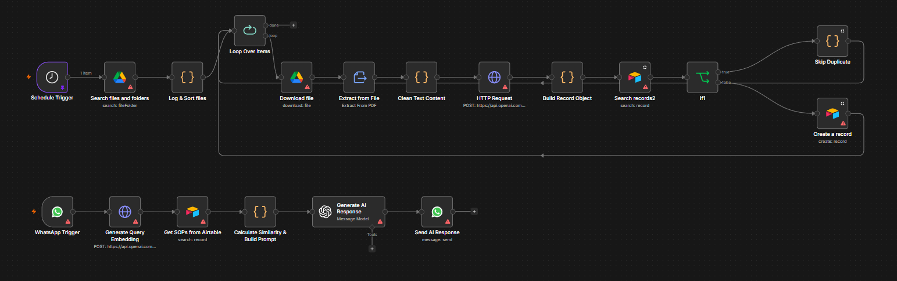

# 📱 WhatsApp Enterprise RAG AI Agent - n8n Reference Template

An end-to-end Retrieval-Augmented Generation (RAG) chatbot reference architecture built entirely within **n8n**. 

**Project Background:** 
*This workflow was originally architected and deployed as a freelance commercial project for a client who needed to automate their internal HR inquiries. The template provided here has been fully sanitized and generalized to serve as a reusable proof-of-concept for integrating WhatsApp, Google Drive, Airtable, and OpenAI to accurately answer user queries using strict, context-bound AI responses.*

 

## Key Features

* **Automated Document Ingestion Pipeline:** Scheduled triggers automatically fetch new PDFs from a designated Google Drive folder, extract and clean the text, generate vector embeddings, and store them in Airtable.
* **Multi-Modal WhatsApp Integration:** Processes text, audio (voice notes), and image inputs via the official WhatsApp API. Uses OpenAI to transcribe audio and analyze images before routing the prompt.
* **Custom RAG & Vector Search:** Utilizes OpenAI's `text-embedding-3-small` model and a custom JavaScript node to calculate cosine similarity, matching user queries against stored text chunks.
* **Strict Context-Grounding:** The AI is strictly prompted to only answer based on retrieved Airtable records, drastically reducing hallucinations.
* **Intent Classification:** Employs an LLM-based routing system to classify inputs as either "Greeting" or "Query", saving processing power and skipping the RAG pipeline for casual salutations.

## Architecture & Tech Stack

* **Workflow Engine:** [n8n](https://n8n.io/)
* **LLM & Embeddings:** OpenAI (`gpt-4o-mini`, `chatgpt-4o-latest` for Vision, `text-embedding-3-small`, Whisper for Audio)
* **Vector Database:** Airtable (storing text chunks and stringified embedding arrays)
* **Document Source:** Google Drive (PDFs)
* **User Interface:** WhatsApp Cloud API

## Workflow Logic Outline

1. **Knowledge Base Sync (Scheduled):**
   * Checks Google Drive for new files.
   * Extracts text using n8n's native PDF extraction.
   * Cleans text, generates an embedding via OpenAI API, and creates a new Airtable record (skipping duplicates using file hashes).
2. **Query Processing (Triggered by WhatsApp):**
   * Receives incoming WhatsApp message.
   * Routes media (downloads and transcribes audio, or analyzes images).
   * Generates an embedding for the user's text prompt.
   * Fetches documents from Airtable and runs a custom JS cosine similarity function.
   * Compiles the top matching records into a highly restrictive system prompt.
   * Generates the final response via `gpt-4o-mini` and sends it back to the user via WhatsApp.

## How to Import & Use

1. Clone this repository and download the `WhatsApp_RAG_Bot_Template.json` file.
2. Open your n8n instance.
3. Go to **Workflows** -> **Add Workflow**.
4. Click the options menu (three dots) in the top right corner and select **Import from File**.
5. Select the downloaded JSON file.
6. **Configure Credentials & Environment:** 
   * Reconnect your credentials for WhatsApp API, OpenAI API, Google Drive OAuth2, and Airtable.
   * Update the generic placeholder variables inside the Airtable, WhatsApp, and Google Drive nodes (e.g., `YOUR_AIRTABLE_BASE_ID`, `YOUR_DRIVE_FOLDER_ID`, `YOUR_WHATSAPP_PHONE_NUMBER_ID`) with your own actual environment IDs.

## Author
**Mohamad Hariz Rafie**
[LinkedIn](https://www.linkedin.com/in/hariz-rafie) | [GitHub](https://github.com/RizFie)